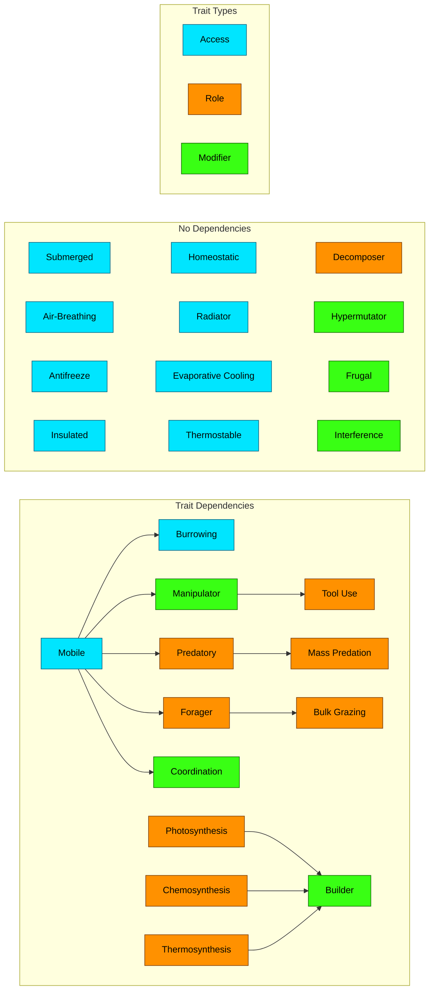

# Scope and details of the game-loop MVP

Published: 25.10.2026

## Overview

Scope and mechanics for a minimal playable slice of Seed Ship, built specifically to test the core evolution loop before any of the wider game's lore, ship, or galaxy systems exist. Covers the technical foundation (a fully code-driven Godot project and its core/autoload/UI architecture), the MVP's scope boundaries, the single planet's biome, medium, temperature, and well model, the energy-flow and feeding mechanics, the mutation and forking system, the full trait catalog, the lineage naming grammar, the three player actions, the visual and interaction design philosophy, and the planned UI views and their visual treatment. Closes with open questions and a separate list of ideas explicitly deferred to the full game.

## Technical Foundation

The MVP is a Godot project, version 4.7.2 pinned exactly rather than left open, so there is no ambiguity about which syntax applies. It is built entirely in code, with no reliance on the visual scene editor, so that every part of the project is plain text and fully inspectable by an AI working on it. A dedicated CLAUDE.md inside the project's code folder describes the architecture and includes a short GDScript 3 versus 4 syntax reference, since AI assistants sometimes default to outdated Godot 3 syntax when not told otherwise.

The codebase separates into three layers, with dependencies running strictly in one direction: a Core layer holding the simulation's data types and logic, an Autoload layer holding the single live instance of the current game state, and a UI layer presenting it. Core classes extend Godot's `RefCounted` rather than `Node` and carry no scene-tree or engine dependency; the turn and fork resolution algorithms are pure functions operating on an explicit world-state snapshot. The Autoload layer owns the one live world-state instance and a signal-only event bus that the UI subscribes to; player actions call into the Autoload layer directly, and the event bus only carries simulation output back out to the UI.

Lineages, biomes, wells, traits, and the world state itself are statically-typed GDScript classes declared with `class_name`, not Dictionaries. All randomness, including fork rolls and the probabilistic rounding of Unit changes, is drawn from a single explicitly-seeded `RandomNumberGenerator` owned by the Autoload layer and passed into whatever needs it, never from Godot's global RNG. There are no `.tscn` files; every `Control` tree is built directly in code. There is no database of any kind; persistence, once needed, takes the form of a serialized snapshot of the Core layer's own data.

Automated testing is out of scope for the MVP. Once introduced, tests live in their own top-level folder, separate from the core, autoload, and UI folders, and run headless against the Core layer directly, using a framework such as GUT or GdUnit4.

## MVP Scope

The MVP is a single screen showing one planet, roughly Earth-like, simulating only carbon-based life. There is one brew type available to seed with. The ship itself is not simulated, and neither is the rest of the galaxy. Time advances through a simple "Next Turn" button, with how much time that represents deliberately left undefined for now. The planet is a single hard-coded setup with hand-picked conditions, rather than something procedurally generated; general world generation, including the planet-wide descriptive label mentioned below, is out of scope for this MVP.

## Biomes

A planet is divided into a small number of biomes, somewhere between two and six, and no two biomes on the same planet are ever identical, though they can be similar. Each biome has a temperature, a medium, and zero or more wells. Biomes carry no size value of their own, since what actually limits a lineage's population is energy access, not physical space. Biomes are treated as fully connected, with no map or adjacency between them: wherever a lineage's current traits make it viable, it is simply present, with no travel or migration step involved.

Eventually every planet will carry a short, auto-generated descriptive label derived from the dominant conditions across its biomes, in the spirit of "Hot, Rocky." The exact generation method is still undecided, and a goal for that method is to avoid falling back to low-information labels like "Mixed." This, like all procedural world generation, is out of scope for the MVP's hand-picked planet.

## Temperature

Temperature sits on a ten-step named scale, numbered 0 through 9:

| Band | Carbon-viable |
|---|---|
| 0 Absolute Zero | No |
| 1 Stone-Shattering | No |
| 2 Freezing | Yes |
| 3 Cold | Yes |
| 4 Temperate | Yes |
| 5 Warm | Yes |
| 6 Hot | Yes |
| 7 Boiling | Yes |
| 8 Stone-Melting | No |
| 9 Plasma-Inducing | No |

Carbon-based life can only ever tolerate the middle six bands, Freezing through Boiling; the two extreme bands at either end are permanently off limits to this order of life regardless of what a given planet offers, reserved for other orders of life in a future version of the game.

A lineage's tolerance is expressed entirely through traits, one for each temperature band it can survive, and there is no free "anchor" band. Every tolerance a lineage has, including the one it starts with, occupies a real trait slot.

## Medium

A biome's medium is a state (vacuum, solid, liquid, gaseous, or plasma) combined with a material (water, silicate, carbon, iron, and so on), shown together as a single tag such as "liquid water." A lineage's access to a given medium is gated both by whether it carries the matching trait and by whether that medium actually exists anywhere on the astrobody at all, so a lineage cannot evolve tolerance for a medium, such as a solid ground, that the planet simply does not have.

## Wells and Energy

Energy sources within a biome are called wells, measured in a unit simply named Energy. Each well has an Output, drawn from a five-step scale with values set an order of magnitude apart:

| Tier | Value |
|---|---|
| Scarce | 100 |
| Marginal | 1,000 |
| Moderate | 10,000 |
| Plentiful | 100,000 |
| Abundant | 1,000,000 |

The MVP only ever uses Scarce, Marginal, and Moderate; Plentiful and Abundant exist for the full game.

| Well | Powers | Placement |
|---|---|---|
| Sunlight | Photosynthesis | Any surface-exposed biome |
| Chemical Seep | Chemosynthesis | Surface or underground, not restricted by depth or darkness |
| Thermal Vent | Thermosynthesis | Deep, underwater biomes only |
| Biomass | Predatory, Forager, Decomposer | Wherever smaller, co-located lineages exist; not a fixed Output, computed fresh each turn |

Biomass is a dynamic well. Rather than a fixed Output, its available amount each turn is the Standing Biomass of every smaller, co-located lineage (an internal figure, never shown directly in the UI), multiplied by the Trophic Efficiency, a fixed value of exactly 0.1 representing how much of a population's biomass is realistically available to whatever feeds on it.

Each turn, a well's Energy Pool (its Output directly, or the computed biomass flow) is split between every lineage drawing on it in proportion to Hunger, each lineage's relative total metabolic need compared to its competitors. Each lineage then converts its allocated share into usable energy through its own Uptake, a factor starting at 0.5 by default and improvable through traits, producing that lineage's Effective Energy for the turn.

A biome's own well readout (its Output-scale rating) and a lineage's personal Effective Energy are two separate, separately displayed numbers: one describes the richness of the place, the other describes how much of it a specific lineage is actually managing to get.

## Lineages, Size, and Population

A lineage's population in a given biome is tracked as a whole number of Units (the term used for one individually counted segment of a lineage), recomputed into biomass fresh each turn rather than carried forward as a continuous value. When a turn's energy math implies a fractional change in that count, the fraction is resolved probabilistically rather than rounded away: a computed change of minus 0.16 Units becomes a flat 16 percent chance of losing one Unit this turn and an 84 percent chance of no change, rather than being silently rounded to zero every time, so a small, persistent trend still shows up over many turns instead of being erased.

Size is one of five tiers, Tiny (3 traits or fewer), Small (4 to 6), Medium (7 to 9), Large (10 to 12), and Massive (13 to 15), and is a pure function of how many traits a lineage currently has. Fifteen traits is a hard ceiling: no lineage can ever hold more than that, regardless of size. No lineage can ever have fewer than 3 traits either, since every lineage starts with at least that many from Seeding.

Every trait count from 3 upward has its own per-Unit Metabolism and Biomass value, both loosely grounded in the real-world gap between something fly-sized and something elephant-sized. Biomass grows by exactly 10x for each additional trait; Metabolism grows by roughly 4.64x per trait, the rate that completes a 100x jump every 3 traits, landing exactly on these values at each size tier's edge:

| Trait Count | Metabolism | Biomass |
|---|---|---|
| 3 (Tiny) | 1 | 1 |
| 4 | 5 | 10 |
| 5 | 22 | 100 |
| 6 (Small) | 100 | 1,000 |
| 7 | 460 | 10,000 |
| 8 | 2,150 | 100,000 |
| 9 (Medium) | 10,000 | 1,000,000 |
| 10 | 46,000 | 10,000,000 |
| 11 | 215,000 | 100,000,000 |
| 12 (Large) | 1,000,000 | 1,000,000,000 |
| 13 | 4,600,000 | 10,000,000,000 |
| 14 | 21,500,000 | 100,000,000,000 |
| 15 (Massive) | 100,000,000 | 1,000,000,000,000 |

Crossing a size threshold, in either direction, happens automatically and immediately whenever a trait is gained or lost. There is no separate size-promotion event, it is simply a consequence of trait count crossing the line.

## Feeding and Competition

A Predatory lineage can feed on biomass from any Mobile lineage strictly smaller than itself. A Forager can feed on Immobile biomass of its own size or smaller. Neither role can ever count its own lineage as prey (cannibalism). Both roles require the lineage itself to be Mobile. By default, feeding reaches exactly one size tier down; the traits Mass Predation and Bulk Grazing remove that cap entirely for predators and foragers respectively, letting a large lineage bulk-process biomass many tiers smaller, the way a filter-feeding whale lives on plankton.

When multiple lineages compete for the same well, including the biomass well, the split is governed entirely by Hunger. No organism is ever actually killed by a predator in this model: the biomass well represents energy that is naturally available for consumption over very long timescales, not individuals being hunted down, so a Predatory or Forager lineage drawing on it has no effect on a prey lineage's own standing population.

## Turn Processing

Every turn resolves from a single frozen snapshot of that turn's starting state. Nothing computed during a turn ever reads a value that was changed during that same turn, only what every lineage's population already was before the turn began; every resulting change, across every well and every biome, is applied simultaneously once the turn's math is finished, becoming the snapshot the next turn starts from.

Each biome resolves entirely independently of every other biome, since nothing in a biome's energy math depends on what's happening elsewhere on the planet. The one exception is forking's one-per-turn cap, which applies across a lineage as a whole rather than separately in each biome it occupies, and so is only resolved once every biome's snapshot is known.

The algorithm, per turn:

1. Take a snapshot of every lineage's population in every biome.
2. In each biome, independently:
   1. Reserve Decomposer's 5% of the biome's total Standing Biomass, isolated from everything below it, and split it among any competing Decomposer lineages by Hunger.
   2. For every other smaller, co-located lineage, compute its own biomass pool from its own Standing Biomass multiplied by the Trophic Efficiency (10%), separate from Decomposer's share and from every other prey lineage's pool, so the same biomass is never counted twice.
   3. For every well, including each prey lineage's own biomass pool, split its Energy Pool among every lineage eligible to draw on it, in proportion to Hunger.
   4. Each lineage converts its allocated share into Effective Energy through its Uptake.
   5. For each lineage, compare its total Effective Energy across everything it draws on against its metabolic cost. The difference becomes a population change for that lineage in that biome, resolved into whole Units through probabilistic rounding. A shortfall is starvation: the population contracts, possibly over more than one turn, until it is back in balance with what it actually receives.
3. Apply every population change from every biome simultaneously, becoming the snapshot the next turn starts from.
4. For each lineage, using its total population across every biome it occupies, determine whether it forks this turn, capped at one fork per lineage regardless of how many biomes it is in.
5. Using the new snapshot, run steps 2 and 3 again as a projection only, assuming no further traits or player actions, to get next turn's percentage population change for every lineage. That projection is exactly what drives the Growth Forecast label shown in the Lineage View, rather than being a separate heuristic.

## Mutation and Forking

Every lineage carries a baseline mutation rate of exactly 0.01 per Unit per turn, representing ordinary replication error; this is never zero. Hazards and certain traits can multiply it, but nothing reduces it below that floor.

Whether a fork actually happens this turn is not just a function of that rate on its own, it also depends on the lineage's total population, following P equals 1 minus (1 minus mutation rate) to the power of N, where N is the number of Units. This is the standard population-genetics formula for the odds that a rare event occurs at least once across N independent chances, one per Unit. A population of one Unit has essentially no chance of forking even with a high mutation rate, while a population of thousands of Units will fork reliably even at a low one. This is also where the earlier point about larger lineages evolving more slowly comes from: growing into a bigger size tier means supporting fewer Units on the same energy budget, which lowers N and therefore lowers the odds of forking, as a direct consequence rather than a separate rule.

Each turn, a lineage may fork at most once, a cap that applies across the whole lineage rather than separately in each biome it occupies, and resets every turn rather than being a lifetime limit, either by gaining one new eligible trait from its mutation pool or by losing one it already has. Losing a trait is a deliberate option alongside gaining one, modeling real evolutionary specialization, the way cave fish lose eyesight once it stops being worth the metabolic upkeep, and it is considerably rarer than gaining one: if a lineage currently has, for example, five eligible traits it could gain, the option to lose one instead is simply a sixth, equally-weighted possibility, a one-in-six chance rather than a coin flip. A lineage can never lose a trait that would leave it unable to survive anywhere on the planet at all, though it is entirely possible for a lineage to specialize down to a single niche by shedding every other access it has. A lineage already at the fifteen-trait ceiling has no eligible gain option left, so any fork it rolls that turn is loss-only.

A fork, in either direction, cannot produce a trait composition that another currently-living lineage already holds. A composition once held by a now-extinct lineage is fair game again under a new name. If every eligible option would collide with a living lineage, no fork happens that turn.

A successful fork creates exactly one founder Unit in the new lineage, at no cost to the parent population.

Which traits are available to roll is controlled by each trait's own gating conditions: required or forbidden other traits, a minimum or maximum size tier, or whether the lineage currently occupies an astrobody where the relevant medium, temperature, or well actually exists. Mutation is never biased toward useful outcomes. Every eligible trait in the pool is equally likely regardless of how helpful it turns out to be.

## Tuning Knobs

Traits are only ever allowed to affect a specific, closed set of numeric levers: metabolic cost, mutation rate, Hunger (a lineage's standing in competition for a well), Uptake (how efficiently an allocated share converts into Effective Energy), and a well's Output.

## Trait Catalog

Every trait belongs to one of four types: Access (what a lineage can physically occupy), Role (how it gets energy), Modifier (it tunes a numeric value), or Other.

| Trait | Type | Effect | Gating |
|---|---|---|---|
| Mobile | Access | Required to feed on biomass via Predatory or Forager specifically; grants plus 20 percent to this lineage's relative share of any well it draws from; prerequisite for several other traits | None |
| Submerged | Access | Tolerates a Liquid medium; granted automatically at Seeding | Astrobody must have a Liquid medium present |
| Air-Breathing | Access | Tolerates a Gaseous medium | Astrobody must have a Gaseous medium present |
| Burrowing | Access | Tolerates a Solid medium | Requires Mobile; astrobody must have a Solid medium present |
| Antifreeze | Access | Tolerates Freezing | Astrobody must have Freezing present |
| Insulated | Access | Tolerates Cold | Astrobody must have Cold present |
| Homeostatic | Access | Tolerates Temperate; granted automatically at Seeding if this is the starting band | Astrobody must have Temperate present |
| Radiator | Access | Tolerates Warm, via passive heat radiation through large surface area | Astrobody must have Warm present |
| Evaporative Cooling | Access | Tolerates Hot, via active evaporative heat loss, stronger than passive radiation | Astrobody must have Hot present |
| Thermostable | Access | Tolerates Boiling, via heat-stable biochemistry | Astrobody must have Boiling present |
| Photosynthesis | Role | Gets energy through solar radiation; Producer on Sunlight | Astrobody must have Sunlight present |
| Chemosynthesis | Role | Producer on Chemical Seep | Astrobody must have Chemical Seep present |
| Thermosynthesis | Role | Producer on Thermal Vent | Astrobody must have Thermal Vent present |
| Predatory | Role | Consumer on Mobile biomass, one size tier smaller | Requires Mobile |
| Forager | Role | Consumer on Immobile biomass, own size or smaller | Requires Mobile |
| Decomposer | Role | A 5% share of Standing Biomass representing unwanted decaying biomass, reserved separately from any Predator or Forager competition; if more than one Decomposer lineage is present, they compete with each other over that 5% the same way any other well-sharing lineages do. Does not require Mobile, though it can have it; whether a Decomposer lineage is itself Mobile or Immobile determines whether Predators or Foragers can in turn feed on it, the same as any other lineage | None |
| Tool Use | Role | Extends feeding reach one extra size tier upward | Requires Manipulator |
| Mass Predation | Role | Removes the downward size-tier cap for Predatory feeding entirely | Requires Predatory; Size Medium or larger |
| Bulk Grazing | Role | Removes the downward size-tier cap for Forager feeding entirely | Requires Forager; Size Medium or larger |
| Hypermutator | Modifier | Doubles this lineage's mutation rate, with no offsetting downside | None |
| Frugal | Modifier | Plus 0.2 to Uptake | None |
| Manipulator | Modifier | Plus 0.2 to Uptake; represents any appendage capable of fine manipulation, a hand, trunk, tentacle, or beak, not a specific anatomical form | Requires Mobile |
| Coordination | Modifier | Acts as if this lineage's metabolic need were 20 percent higher when competing for a well, representing coordinated group access to a resource rather than lone competition | Requires Mobile |
| Interference | Modifier | Reduces every other competing lineage's Hunger points by 20 percent when splitting a well, rather than boosting its own; represents actively obstructing or harassing rivals away from a resource rather than simply out-consuming them | None |
| Builder | Modifier | Doubles one well's Output in a biome this lineage occupies, matched to its own producer role; applied once and lasting only as long as this specific lineage remains present there, and a well can only ever be claimed by one Builder lineage at a time | Requires Photosynthesis, Chemosynthesis, or Thermosynthesis |

The chart below shows the same catalog colored by type per the legend. Traits with no "Requires" gating and no trait that depends on them sit in their own "No Dependencies" box, kept visually separate from the actual dependency chain in the "Trait Dependencies" box below it.

## Lineage Naming

A lineage's name is generated once, at the moment it comes into existence, either at Seeding or at the fork that splits it off from a parent, and never changes afterward; since a fork always produces a brand new lineage without altering the parent at all, the parent's own name is simply never touched by anything that happens to its descendants.

A name is built from a small, fixed number of **slots**, each slot bound to one specific trait the lineage holds and filled with a single word drawn from that trait's own vocabulary. A lineage below Size Medium carries two slots; one at Size Medium or larger carries three. Every trait that can anchor a slot needs its own pair of word lists, authored by hand rather than produced by a shared suffix rule, so each entry already fits its slot grammatically and nothing is derived at generation time: a **Descriptor** list (a standalone adjective or noun, such as "Vector" or "Mole") and a **Head** list (an already-plural noun for whoever enacts the trait, such as "Migrators" or "Excavators"). A word belongs to exactly one list across the whole catalog, never two.

The two base slots are always combined using one of three **Core** grammars:

| Core grammar | Pattern | Example |
|---|---|---|
| Qualifier | a Descriptor word and a Head word, hyphenated | Vector-Migrators |
| Kinship | two Head words, hyphenated | Cursors-Diggers |
| Fusion | a Descriptor word and a Head word, fused into one word | Vectormigrators |

A newly created lineage without a parent rolls its Core grammar fresh; one created by a fork instead copies its parent's Core grammar and its two base slots unchanged, then picks one of those two slots at random and rebinds it to whichever trait the fork just gained, drawing a fresh word from that trait's own list.

A lineage born at Size Medium or larger carries a third slot, combined with the Core using one of two **Extension** grammars, rolled fresh the moment that slot first exists and left unchanged for as long as it does:

| Extension grammar | Pattern | Example |
|---|---|---|
| Foreword | a Descriptor word, prepended before the Core | Momentum Vector-Migrators |
| Epic | a connective (drawn fresh, each time this slot's word changes, from "of the," "in the," "at the," "beneath the," "beyond the," "under the," or "near the") followed by a Descriptor word, appended after the Core | Vector-Migrators beneath the Crust |

A fork whose gained trait first carries a lineage's trait count past the Medium floor adds this third slot, bound to that trait, rather than rebinding one of the two base slots. A fork whose lost trait is the one a slot is bound to drops that slot instead.

A freshly generated name is checked against every name ever assigned on the planet, not only names currently in use, and a collision rerolls a different word for whichever slot just changed until the result is unique; a name is never reused, even once the lineage that held it has gone extinct.

Word lists exist so far only for Mobile and Burrowing, given below as a first draft meant to be refined rather than a locked catalog; every other trait needs its own pair of lists before this system can name a lineage that doesn't carry one of these two.

| Trait | List | Words |
|---|---|---|
| Mobile | Descriptor | Vector, Transit, Velocity, Momentum, Trajectory, Range, Transposition, Impetus, Drift, Migration |
| Mobile | Head | Migrators, Cursors, Transients, Nomads, Vagrants, Transiters, Mobilizers, Drifters, Locomotors, Runners |
| Burrowing | Descriptor | Tunnel, Cavity, Sediment, Bedrock, Crust, Depth, Mantle, Vein, Warren, Substrate |
| Burrowing | Head | Excavators, Diggers, Tunnelers, Borers, Miners, Delvers, Grubbers, Moles, Infiltrators, Rooters |

## Player Actions

All three actions below are triggered contextually, from within the Biome or Lineage view they apply to, rather than through a separate global action menu.

**Seed** marks the planet as hosting carbon-based life and creates a new lineage with exactly three starting traits: Submerged, whichever temperature trait matches the randomly chosen liquid-medium biome it begins in, and a random eligible Producer trait (Photosynthesis, Chemosynthesis, or Thermosynthesis, whichever wells the planet actually has), since a lineage needs some means of getting energy from its very first turn.

**Irradiate** doubles the mutation rate in a chosen biome for the following turn, at the cost of an immediate 20 percent population loss there; it can be used more than once in a single turn.

**Cull** removes 50 percent of a chosen lineage's population in a biome; it can likewise be used more than once in a single turn.

A further, not yet designed mechanic for the full game is marking one lineage as the player's favorite, or patron: a status that would unlock additional actions specific to that lineage and give it preferential treatment in the UI.

## Visual and Design Philosophy

Every visual element encodes real information; nothing is drawn purely for atmosphere without also representing something a player can act on or learn from. Prominence follows the same rule: a larger or more emphasized element carries more information than a smaller one, never just more emphasis for its own sake.

Life forms are never depicted literally. The game's premise spans an enormous range of possible life, and any concrete rendering of a body, however stylized, narrows that range and forecloses what a player can imagine a given lineage to be; the intended effect happens in the player's own head, not on screen. Wells, biomes, and other non-living elements of the simulation are rendered more freely, provided the result stays legible rather than photographic.

Text is a first-class visual medium, not a fallback for when art is unavailable. The game is mostly text, and arrangement, alignment, grouping, and typographic hierarchy count as real visual design; the interface reads as an instrument panel rather than a spreadsheet, through deliberate layout and negative space rather than through added illustration.

A visual idiom, once established for one view, is reused rather than reinvented for the next: the same globe rendering appears at planet scale and at lineage scale, the same line-trace language represents competition for a well and a lineage's wider relationships, and the same arrow-and-color convention represents a population trend wherever one is shown. The interface stays learnable as one coherent system rather than as separate screens.

The project favors the simplest solution that solves the problem at hand, and every system described in this document, visual or technical, is subject to substantial change as the design matures.

## Views

A **Planet View** is rendered as a diagrammatic globe: a sphere with a limb shadow and a lit/unlit terminator, its surface divided by great-circle lines into one wedge per biome. Each wedge runs that biome's own atmospheric shader (described below under Biome View) at reduced scale, so the globe's appearance comes entirely from the planet's actual biome data rather than from generic terrain art; clicking a wedge opens that biome's Biome View directly. A lineage summary panel sits alongside the globe, giving the same screen both planetary navigation and a first look at what currently lives there.

A **Lineage View**, opened from there or from the Lineage Tree, shows a lineage's full name, a one-line note naming its parent lineage, every biome it currently occupies (a smaller instance of the same diagrammatic globe, with only the occupied wedges highlighted and annotated with each biome's local population and trend arrow), its complete trait list grouped by the catalog's four types and shown as compact badges, an itemized ledger-style breakdown of its Uptake (base value plus each contributing trait, summing to a total), a line-trace diagram of its relationships with other lineages it preys on, is preyed on by, or competes against for a well, and a five-step growth forecast based on that lineage's per-turn population change, a plain label painted over the underlying numeric simulation rather than a separate mechanic of its own:

| Label | Per-turn population change |
|---|---|
| Collapsing | Below -25% |
| Declining | -25% to -5% |
| Steady | -5% to +5% |
| Growing | +5% to +25% |
| Thriving | Above +25% |

A **Biome View** shows every lineage present in one biome alongside that biome's own conditions, rendered as a procedural atmospheric field, built as a shader, whose motion, light, and color grammar differs by biome archetype - a cave as dark and nearly static with rare long-interval ripples and point-flares at seep locations, a deep-sea biome as a continuously flowing, domain-warped current with a thermal gradient rising from any vent, a desert as a bright, static composition with fast heat-haze shimmer and jagged cracked-ground edges - reflecting each biome's actual medium, well, and temperature profile rather than depicting a literal landscape. Wells sit on a separate layer on top of this field: each well type carries its own fixed glyph and motion signature independent of the background, with a contrast guarantee against whatever is behind it, since a well is more important information than the atmosphere around it. Each well's Hunger-based split among competing lineages is drawn as a bar, subdivided by each lineage's current share and labeled with a short fixed-width code rather than a full name; direct competition for the same well is additionally shown as a line trace of each competing lineage's relative share over recent turns. A lineage's population trend, wherever shown, is read through a small arrow (up, up-and-to-the-side, level, down-and-to-the-side, down) colored green, white, or red, rather than through a sparkline or a raw percentage.

A **Lineage Tree** visualizes forking as it happens, covering physical evolution only, since the MVP does not model culture or sapience. Each node is a lineage card showing its name and a brief status read; edges follow fork relationships; an extinct lineage stays visible, marked as such rather than removed, so the tree remains a complete history rather than a current snapshot. Clicking a node opens that lineage's Lineage View.

A small **Log** panel sits on the right side of the screen, expandable or minimized rather than full-screen, recording what happened turn by turn.

A persistent key-data strip, visible regardless of which view is open, is a further idea still needing design: a small set of the most decision-relevant numbers kept on screen at all times. Whether it tracks a single lineage, or something broader and more player-focused, and exactly what belongs in it, is undecided.

## Notes for the Full Game (Out of Scope for the MVP)

- Other orders of life beyond carbon, each with its own temperature anchor and trait catalog, for example plasma-based or silicate and melt-based life.
- A tech or gear-gated action allowing a permanent boost to a well, tied into ruins and ship progression, as a more controlled version of a bare well-boosting action.
- Parasite and Symbiont as direct lineage-to-lineage traits: a parasite skimming a cut of a host's own Effective Energy, and a symbiont granting its host a bonus in exchange for guaranteed access.
- A Hibernation trait letting a lineage freeze entirely: zero metabolic cost, zero energy draw, no trait or fork progress, and immune to being fed on while active. Deferred since what would actually trigger entering or leaving that state was never settled.
- Alternative gas chemistries for carbon-based respiration beyond oxygen, such as methane, and a closer look at what breathing actually means across submerged and land-dwelling life generally.
- Whether the no-duplicate-composition rule on forking should apply across the whole universe once the game spans more than one planet, rather than staying scoped to a single planet as it is now.
- General procedural world generation, including the bottom-up planet label described above and a guarantee that any astrobody with solid material gets at least one Solid-medium biome, so Burrowing always has somewhere to go.
- Reconciling the lineage size scale with the original Steps ladder toward sapience and the planned culture matrix; the traits Coordination, Manipulator, and Tool Use are deliberately named as future bridges toward that system.
- An Airborne trait for active flight. It clearly benefits a Predator reaching prey that is also airborne, but it is not clear what it would offer a Producer or a Forager, so it is deferred until that is resolved.
